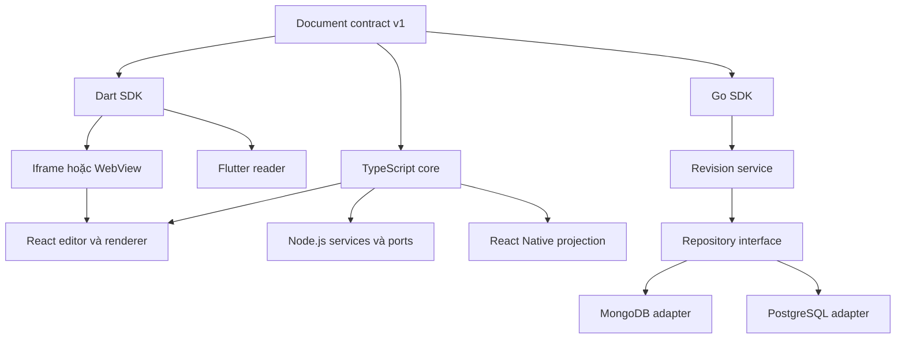

# Kiến trúc DisNote Document Library

Bộ tài liệu này mô tả mã nguồn được kiểm tra ngày 20/11/2026. Các phiên bản trong manifest là phiên bản của checkout, không phải xác nhận đã phát hành lên registry.

**Lộ trình cho dev mới:** đọc mục 5 để hiểu JSON, mục 13–16 để hiểu dữ liệu nằm ở đâu và thay đổi ra sao, sau đó làm bài thực hành trong hướng dẫn nền tảng. Khi custom, bắt đầu từ ví dụ `consumer.notice` trong TypeScript; Flutter và Go dùng lại cùng hợp đồng dữ liệu đó.

## 1. Đọc tài liệu nào?

| Tài liệu | Nội dung |
|---|---|
| [Kiến trúc](ARCHITECTURE.md) | Mô hình dữ liệu, module, luồng xử lý, bảo mật và mở rộng |
| [TypeScript](TYPESCRIPT.md) | React, React Native, backend Node.js/NestJS, spreadsheet và phát hành npm |
| [Backend Go](GO_BACKEND.md) | SDK Go, Gin, Uber Fx, revision, database và hợp đồng HTTP |
| [Frontend Flutter](FLUTTER.md) | Dart model, reader, iframe/WebView editor, NestJS client và pub.dev |

Đây là bốn tài liệu chính trong `docs/`. README, changelog và giấy phép nằm ở từng package phục vụ việc đóng gói/phát hành.

## 2. Mục tiêu và ranh giới

DisNote sở hữu định dạng tài liệu bền vững, validation, migration và các hợp đồng tích hợp. BlockNote là adapter chỉnh sửa web; dữ liệu nội bộ của editor không phải định dạng lưu trữ công khai.

| Thành phần | Vai trò | Không tự đảm nhận |
|---|---|---|
| `@disnote/core` | Document model, registry, builders, validation và các subpath chuyên biệt | Đăng nhập, vận hành API và database của sản phẩm |
| `@disnote/react` | Editor/view facade cho React, runtime dependencies và CSS | Tự lưu dữ liệu hoặc quyết định quyền truy cập |
| `@disnote/sheets` | Engine workbook độc lập, công thức, chuyển đổi và persistence ports | Giao diện bảng tính hoàn chỉnh |
| `sdks/flutter` | Dart model, renderer, editor bridge, Nest client và session | Editor Dart thuần tương đương BlockNote |
| `../DisNote-Go-SDK` | Model, validation, canonical checksum, revision, Gin/Fx và storage | Toàn bộ tính năng của nền tảng TypeScript |

Ứng dụng Flutter có thể tiếp tục dùng NestJS. Việc có Go SDK không bắt buộc thay backend.

## 3. Sơ đồ phụ thuộc



Core model không import React hay BlockNote. Adapter UI, database và transport nằm ngoài core. Composition root của ứng dụng cung cấp dependency theo interface.

## 4. Cấu trúc nguồn

| Đường dẫn | Nội dung |
|---|---|
| `packages/disnote/src/core` | Model, registry, validation, security, migration, serialization và transforms |
| `packages/disnote/src/presets` | Preset article, legal, workspace |
| `packages/disnote/src/editor` | Canonical/editor adapter và React facade |
| `packages/disnote/src/react` | `DocumentEditor`, `DocumentView`, `DocumentPage` |
| `packages/disnote/src/renderer-*` | React, HTML và native renderer |
| `packages/disnote/src/storage`, `persistence` | Revision contracts, repositories, browser/Mongo/PostgreSQL adapters |
| `packages/disnote/src/database`, `workspace` | Record database, cây trang và các control React |
| `packages/disnote/src/comments`, `assets`, `search-ai` | Ports và nghiệp vụ theo capability |
| `packages/disnote/src/collaboration`, `offline`, `mobile` | Đồng bộ, hàng đợi offline và bridge |
| `packages/disnote/src/import-export` | Markdown, HTML, bundle, Notion và DOCX |
| `packages/react` | Package tích hợp React tiện dụng |
| `packages/sheets` | Spreadsheet engine độc lập |
| `contracts/go/v1` | Fixture hợp đồng dùng chung giữa các runtime |
| `scripts/export-runtime-contracts.mjs` | Xuất fixture sang Flutter và Go |
| `sdks/flutter/lib` | API Dart công khai và implementation Flutter |
| `examples` | Ví dụ React, Next.js, Nest legal service, collaboration server |
| `../DisNote-Go-SDK` | Repository Go riêng, không phải npm workspace |

Danh sách import hợp lệ phải đối chiếu với `exports` của từng `package.json`. Tên thư mục implementation không luôn trùng với import công khai: ví dụ `renderer-native` được import bằng `@disnote/core/renderer/native`.

## 5. Document contract

```json
{
  "format": "disnote-document",
  "schemaVersion": 1,
  "id": "doc_example",
  "metadata": {
    "title": "Ví dụ",
    "locale": "vi",
    "createdAt": "2026-11-20T00:00:00.000Z",
    "updatedAt": "2026-11-20T00:00:00.000Z"
  },
  "blocks": [{
    "id": "block_example",
    "type": "paragraph",
    "version": 1,
    "props": {},
    "content": [{ "type": "text", "text": "Nội dung" }]
  }]
}
```

Mỗi block có ID, type, version, JSON props, inline content tùy chọn và children tùy chọn. Inline gồm text, link, mention và reference. Text marks gồm bold, italic, underline, strike, code, textColor và backgroundColor. Superscript/subscript và các cấu trúc nâng cao phải đi qua hợp đồng thực tế của block/editor; không tự thêm mark chưa được validator hỗ trợ.

Ba phiên bản độc lập: phiên bản package, `schemaVersion` của document và `version` của block. Nâng npm package không đồng nghĩa tự đổi schema. Canonical JSON/checksum dùng để so sánh nội dung; checksum không thay thế chữ ký hoặc phân quyền.

Unknown block có thể được bảo toàn ở chế độ permissive. Khi ghi dữ liệu nghiệp vụ, host cần registry đầy đủ và policy cho unknown block; TypeScript revision repository dùng strict validation. Unknown block được giữ không có nghĩa mọi renderer đều hiển thị được.

## 6. Luồng đọc, sửa và lưu

1. Backend xác thực người dùng và kiểm tra quyền đối với document/workspace/channel.
2. Repository trả canonical document cùng revision hiện tại.
3. UI render document hoặc chuyển qua editor adapter.
4. Editor trả canonical document; hook/controller phía client quản lý draft và trạng thái lưu.
5. Request lưu gửi document, revision mong đợi và idempotency key.
6. Backend kiểm tra lại quyền, ID, schema, block props và hạn mức đầu vào.
7. Repository ghi nguyên tử bằng CAS; thành công tạo revision mới, xung đột giữ nguyên draft phía client.
8. Host phát sự kiện sau khi persistence thành công; thông báo realtime không thay thế receipt lưu.

`currentRevision` là revision nội dung. Store CAS version có thể đổi khi publish/archive mà không tạo nội dung mới. Không hoán đổi hai giá trị này.

TypeScript repository có draft/publish/unpublish/archive và truy vấn published revision. Go service hiện có create/read/save draft; trường status trong model không chứng minh đã có API publish.

## 7. Editor theo nền tảng

| Nền tảng | Đọc | Chỉnh sửa |
|---|---|---|
| React Web | `DocumentView`/`DocumentRenderer` | `DocumentEditor` hoặc `DisNoteEditor` |
| Node.js | HTML/SSR, plain text và dữ liệu canonical | Thay đổi bằng builders/transforms/service |
| React Native | `DocumentNativeRenderer`, inject native primitives | `NativeDocumentEditor`, inject WebView tới trang React |
| Flutter Web | `DisNoteDocumentView` | Iframe sandbox qua `DisNoteDocumentEditor` |
| Flutter Android/iOS | `DisNoteDocumentView` | WebView qua cùng widget editor |
| Go | Model, validation, checksum và revision service | API backend; không có UI renderer/editor |

Bridge là giao thức message có version, kiểm tra document ID, loại message và kích thước. Trang editor phải được triển khai riêng trên origin tin cậy. Callback thay đổi chỉ là draft mới; chưa phải bằng chứng đã lưu backend.

## 8. Module nghiệp vụ mở rộng

| Module | Tích hợp tại host |
|---|---|
| Database/workbench | Provider có quyền hiện tại, record CRUD/query/view, record-document access |
| Workspace | Repository cây trang, move/trash/restore/backlink/shared-source |
| Comments/mentions | Provider đọc/ghi thread, tìm mention có phân quyền |
| Assets | Upload/presign, quota, MIME/size, scan và signed URL do backend sở hữu |
| Collaboration | Yjs provider, identity, token, persistence update và generation fence |
| Offline | Queue/cache cục bộ và giải quyết xung đột khi kết nối lại |
| Search/AI | Projection và provider được inject; quyền đọc và credentials ở server |
| Automation | Scheduler/webhook executor và policy server-side; UI không tự thực thi quyền |
| Sheets | Workbook riêng; liên kết với document bằng ID nếu sản phẩm cần |

Các provider tham chiếu/demo không đại diện cho một deployment production. Với realtime, host phải xử lý thu hồi quyền, reconnect, seed duy nhất và replay; không seed độc lập cùng nội dung vào mỗi Y.Doc.

## 9. Chuyển đổi và mức bảo toàn

Canonical JSON là nguồn lưu trữ. Markdown và HTML là định dạng trao đổi có thể mất metadata, ID hoặc custom block; đọc warnings khi chuyển đổi.

DOCX do DisNote tạo chứa nội dung Word và snapshot canonical kèm checksum. Import khôi phục snapshot chỉ khi kiểm tra hợp lệ. Nếu Word content bị sửa hoặc file đến từ bên ngoài, importer chuyển sang semantic parsing và phát diagnostics; không có cam kết giữ nguyên mọi bố cục Word.

XLSX trong sheets có cơ chế snapshot/semantic fallback riêng. Spreadsheet và document không dùng chung model. PDF/Excel/Word fidelity cần kiểm chứng theo file thật; không suy ra từ việc export tạo được byte array.

## 10. SOLID, mở rộng và migration

- Controller xử lý transport; service xử lý nghiệp vụ; repository xử lý database.
- UI component hiển thị; hook/session quản lý draft và side effects; serializer/validator tách riêng.
- Custom block cần schema, props validator, plain-text projection, migration và renderer tương ứng từng nền tảng.
- Mở rộng qua registry/preset, provider hoặc strategy; không patch vendor editor để thay định dạng canonical.
- Migration có tính quyết định, không gọi network, không phụ thuộc user hiện tại và không sửa dữ liệu gốc khi lỗi.
- UI host dùng từ điển vi/en; event names, storage keys, routes và error identifiers đặt trong constants.

## 11. Bảo mật và vận hành

Client-side `editable`, `canManage` hoặc `canEdit` chỉ điều khiển UI. Node host phải bọc repository bằng authorization service; Go service yêu cầu `revision.Policy` và mặc định từ chối khi thiếu policy.

Không lấy actor từ body/header tự khai báo rồi tin cậy. Không đưa access/refresh token vào editor URL. Giới hạn request body, nesting depth, ZIP/XML expansion, asset origins và thời gian xử lý import. Custom HTML renderer phải escape dữ liệu và kiểm tra URL.

Repository aggregate chứa cả lịch sử có thể tăng kích thước theo thời gian. Cần thiết kế retention/compaction và đo tải trước khi dùng cho lịch sử lớn. Live database, thiết bị thật, IME, bàn phím, offline, thu hồi quyền và deployment cần các gate riêng.

## 12. Bản đồ kiểm chứng tài liệu

| ID | Yêu cầu | Nguồn đối chiếu |
|---|---|---|
| DOC-01 | Đúng bốn tài liệu chính | Bốn file Markdown trong `docs/` |
| DOC-02 | Kiến trúc và contract đúng nguồn | `core/model`, registry, storage, `package.json` exports |
| DOC-03 | React/React Native/Node.js | `react/index.tsx`, `renderer-native`, `mobile`, `persistence` |
| DOC-04 | Go/Gin/Fx | `../DisNote-Go-SDK/{revision,transport/gin,fxmodule,storage}` |
| DOC-05 | Flutter Web/mobile và Nest client | `sdks/flutter/lib`, pubspec và publish workflow |
| DOC-06 | Liên kết và ví dụ hợp lệ | Kiểm tra file đích và đối chiếu chữ ký API; build/test được báo riêng theo lần chạy |
| DOC-07 | Dev hiểu dữ liệu và vòng đời lưu trữ | Mục 13–16: state sinh từ repository, wrapper Mongo, DDL SQL, revision/publish/restore, assets và offline |
| DOC-08 | Custom có ví dụ liên runtime | `consumer.notice`: schema/validator, preset, reader React/HTML/native/Flutter, host validation Go và migration |
| DOC-09 | Có bài thực hành đi từ đầu đến kết quả | Lifecycle Node chạy được, chương trình Go hoàn chỉnh và reader Flutter độc lập; phạm vi kiểm chứng mỗi runtime được báo riêng |

Đây là bản đồ nguồn cho tài liệu, không phải nghiệm thu UI/API/database/realtime của sản phẩm. Việc sửa tài liệu không bổ sung endpoint, policy hoặc khả năng runtime mới.

## 13. Dữ liệu thực sự được lưu như thế nào?

### 13.1. Phân biệt năm loại dữ liệu

| Loại | Ví dụ | Nơi lưu phù hợp | Có nằm trong canonical document không? |
|---|---|---|---|
| Nội dung | Heading, paragraph, custom block | Snapshot `revisions[n].document` | Có |
| Quản lý xuất bản | Slug, status, current/published revision | `stored` trong state | Không; đây là metadata quản lý repository |
| Lịch sử | Snapshot, checksum, actor và thời gian mỗi lần lưu | `revisions` trong adapter aggregate hiện có | Không nằm trong một document đơn lẻ |
| Tài nguyên nhị phân | PNG, video, file đính kèm | Object storage; database giữ asset record | Chỉ giữ `assetId`/props tham chiếu |
| Trạng thái giao diện | Selection, menu mở, panel, spinner | State của component/hook/session | Không |

User/workspace/channel membership, ACL, comments và Yjs updates là các aggregate/contract riêng. Việc document chứa `reference` hoặc `databaseId` không nhúng toàn bộ dữ liệu của đối tượng đó vào document và không cấp quyền đọc đối tượng đó.

Không cần tạo một collection/table cho mỗi paragraph khi dùng adapter aggregate hiện tại. Toàn bộ cây blocks nằm trong JSON snapshot. Nếu cần tìm kiếm theo block hay analytics, xây projection/index riêng có thể tái tạo từ canonical data; đừng biến projection thành nguồn nội dung thứ hai.

### 13.2. Một state hoàn chỉnh sau khi create

Ví dụ sau được sinh từ `RevisionDocumentRepository` với clock cố định. Đây là **state nội bộ của TypeScript reference repository**, không phải response bắt buộc cho mọi HTTP API của sản phẩm:

```json
{
  "id": "doc_intro",
  "revision": 1,
  "stored": {
    "id": "doc_intro",
    "slug": "gioi-thieu",
    "locale": "vi",
    "kind": "ARTICLE",
    "title": "Giới thiệu",
    "status": "draft",
    "currentRevision": 1,
    "schemaVersion": 1,
    "createdBy": "user_01",
    "createdAt": "2026-11-20T00:00:00.000Z",
    "updatedAt": "2026-11-20T00:00:00.000Z"
  },
  "revisions": [{
    "documentId": "doc_intro",
    "revision": 1,
    "document": {
      "format": "disnote-document",
      "schemaVersion": 1,
      "id": "doc_intro",
      "blocks": [{
        "id": "block_intro",
        "type": "paragraph",
        "version": 1,
        "props": {},
        "content": [{ "type": "text", "text": "Xin chào" }]
      }],
      "metadata": {
        "createdAt": "2026-11-20T00:00:00.000Z",
        "updatedAt": "2026-11-20T00:00:00.000Z",
        "title": "Giới thiệu",
        "locale": "vi"
      }
    },
    "plainText": "Xin chào",
    "checksum": "4381312be7322d3a53877871d19e67be3e8643624e159e6b628a6854c5578470",
    "createdBy": "user_01",
    "createdAt": "2026-11-20T00:00:00.000Z",
    "source": "editor"
  }],
  "idempotency": {}
}
```

`stored.title` dùng cho danh sách/quản lý; `document.metadata.title` đi cùng nội dung. Khi save draft, repository cập nhật stored title từ document nếu có. `stored.updatedAt` là thời điểm repository ghi; repository không tự sửa mọi field timestamp bên trong document. Host phải định nghĩa rõ quyền sở hữu metadata để không nhầm thời gian do client gửi với audit time server.

`plainText` là projection phục vụ tìm kiếm/preview, không đủ để khôi phục document. `checksum` được tính bởi thư viện; không tự copy checksum cũ sang nội dung mới.

### 13.3. MongoDB lưu một record bọc state

Adapter TypeScript tạo record có các trường sau; MongoDB có thể thêm `_id`:

| Trường ngoài | Giá trị lấy từ đâu | Tại sao có bản sao? |
|---|---|---|
| `id` | `state.id` | Định danh document và unique index |
| `revision` | `state.revision` | Predicate CAS cho update nguyên tử |
| `slug`, `locale` | `state.stored` | Unique index và tìm published content |
| `state` | Toàn bộ state ở ví dụ trên | Snapshot aggregate bền vững |

Ứng dụng chọn collection name, ví dụ `document_states`. Adapter không hardcode tên collection. Index bắt buộc: unique `{id: 1}` và unique `{slug: 1, locale: 1}`. Khi save, filter gồm cả ID và revision ngoài; chỉ một writer có revision đúng được cập nhật.

### 13.4. PostgreSQL lưu state vào JSONB

DDL tương ứng adapter TypeScript mặc định:

```sql
CREATE TABLE IF NOT EXISTS disnote_document_states (
  id TEXT PRIMARY KEY,
  revision INTEGER NOT NULL CHECK (revision > 0),
  slug TEXT NOT NULL,
  locale TEXT NOT NULL,
  state JSONB NOT NULL,
  UNIQUE (slug, locale)
);
CREATE INDEX IF NOT EXISTS disnote_document_states_updated_at_idx
  ON disnote_document_states ((state->'stored'->>'updatedAt'));
```

Go adapter dùng `BIGINT` cho revision và không tạo cùng expression index. Schema tương tự không bảo đảm hai runtime có thể đồng thời ghi chung bảng một cách an toàn: phải kiểm chứng field mapping, serialization, validation, policy và CAS trên dữ liệu thực tế trước khi cho hai writer cùng sở hữu aggregate.

Truy vấn sau dùng để **chẩn đoán dữ liệu**, không thay authorization API:

```sql
SELECT id, revision AS store_revision,
       state->'stored'->>'currentRevision' AS content_revision,
       state->'stored'->>'publishedRevision' AS public_revision,
       jsonb_array_length(state->'revisions') AS snapshot_count
FROM disnote_document_states
WHERE id = 'doc_intro';
```

## 14. Ví dụ đầy đủ về vòng đời dữ liệu

Giả sử sau create có content revision 1 và store revision 1:

| Thao tác | Content revision | Store revision | Published revision | Snapshot mới? |
|---|---:|---:|---|---|
| Create bản A | 1 | 1 | Chưa có | A ở revision 1 |
| Save bản B, expected=1 | 2 | 2 | Chưa có | B ở revision 2 |
| Publish revision 2 | 2 | 3 | 2 | Không |
| Save bản C, expected=2 | 3 | 4 | 2 | C ở revision 3 |
| Restore nội dung A bằng save draft, expected=3 | 4 | 5 | 2 | Bản sao A ở revision 4 |
| Publish revision 4 | 4 | 6 | 4 | Không |

Public reader vẫn thấy B sau khi C được lưu nháp. Restore không xóa revision 2/3 và không tự publish. Publish làm store revision tăng nhưng client lưu nội dung tiếp theo vẫn dùng `currentRevision`, không dùng store revision.

### Hai người cùng sửa

Lan và Nam đều mở content revision 2. Lan lưu trước, server trả revision 3. Nam gửi expected=2; server trả conflict và giữ revision 3. UI Nam giữ draft, hiển thị lựa chọn so sánh/merge/tải lại. Nếu host muốn merge, tạo nội dung đã merge dựa trên server revision mới rồi gửi một operation mới. Tự đổi expected=3 mà không review có thể ghi đè thay đổi của Lan.

### Retry vì mất response

Server đã nhận operation `op-42`, tạo revision 3 nhưng client mất mạng trước khi nhận response. Client retry **đúng payload** với `op-42`; receipt giúp trả revision đã nhận. Nếu người dùng sửa tiếp thành payload khác, dùng operation key mới. Reference receipt map cần host bổ sung actor/payload binding và retention như hướng dẫn nền tảng.

## 15. Asset, comment, database và dữ liệu offline

### Asset upload

1. Client yêu cầu backend cấp quyền upload với MIME/size dự kiến.
2. Backend kiểm tra actor, quota và loại file rồi cấp URL upload giới hạn thời gian.
3. Client upload binary vào object storage.
4. Backend xác nhận/scan và tạo hoặc cập nhật asset record.
5. Document lưu block chứa asset ID; khi đọc, resolver lấy URL được cấp quyền hiện tại.

Không lưu nguyên video hoặc base64 ảnh lớn vào mỗi revision. URL ký có thời hạn không nên là ID bền vững. Xóa một block khỏi draft không đồng nghĩa được xóa ngay binary: revision cũ, published document hoặc tài liệu khác có thể còn tham chiếu. Cần garbage collection theo reference/retention policy của sản phẩm.

Comments có author, thread, status và anchor riêng. Database records và workbook cells có repository riêng. Một document block trỏ đến database/workbook không làm các record/cell tự nằm trong lịch sử document. Nếu sản phẩm cần restore đồng thời body và records/comments, phải thiết kế transaction/snapshot tổng hợp riêng; tính năng đó không tự xuất hiện từ `saveDraft`.

### Offline

RAM draft, cache cục bộ và server snapshot là ba trạng thái khác nhau. Có RAM draft không bảo đảm sống qua app kill. Cache không cấp quyền đọc mãi sau khi logout/revoke. Host chọn storage local, khóa mã hóa nếu cần, namespace theo tài khoản, TTL và cách dọn khi logout. Hàng đợi cần lưu document ID, base revision, operation key, payload và trạng thái receipt; không enqueue token bí mật lâu dài cùng payload.

## 16. Tự viết repository và vận hành dữ liệu

Tự thay Mongo/PostgreSQL adapter chỉ khi implementation mới giữ các invariants:

1. Create là insert-if-absent, đồng thời enforce uniqueness ID và slug/locale.
2. Update so sánh CAS và ghi toàn bộ thay đổi nguyên tử; không tách `SELECT` rồi `UPDATE` không có predicate version.
3. Read trả bản sao/giá trị độc lập; sửa object trong service không tự sửa state đã lưu.
4. History giữ snapshot/checksum nhất quán; rollback transaction không để receipt thành công giả.
5. Policy vẫn ở application boundary; đổi database không được làm mất tenant scope.

Khóa uniqueness hiện tại là slug/locale toàn collection/table, **không có tenant ID trong index**. Nếu mỗi workspace cần slug trùng nhau, host phải thêm tenant namespace có kiểm soát hoặc viết repository contract/adapter phù hợp; chỉ thêm field `workspaceId` vào JSON không làm constraint thay đổi.

Khi backup, lưu database snapshots cùng object-storage assets và schema/fixture version cần để đọc chúng. Khi restore sang staging, kiểm tra canonical validation, published revision, history, asset resolution và quyền trước khi chuyển traffic. Tạo HTML/index lại từ canonical data thay vì lấy HTML cache làm bản backup nội dung.

Việc tách aggregate thành các bảng `documents`, `revisions`, `receipts` là phương án mở rộng do host triển khai, chưa phải layout của adapter aggregate hiện tại. Cần transaction hoặc cơ chế commit tương đương để các bảng vẫn nhất quán. Không đổi layout bằng hướng dẫn SQL thủ công rồi tiếp tục dùng adapter cũ.

## 17. Từ điển cho dev mới

| Thuật ngữ | Hiểu trong tài liệu này |
|---|---|
| Canonical document | JSON gốc mà các nền tảng cùng hiểu; từ đây có thể render hoặc chuyển đổi |
| Snapshot | Bản sao toàn bộ nội dung ở một thời điểm, không chỉ phần text vừa thay đổi |
| Content revision | Số phiên bản nội dung tăng sau một lần lưu được chấp nhận |
| CAS, compare-and-swap | Chỉ ghi nếu version database vẫn đúng như lúc mình đọc; tránh hai writer âm thầm ghi đè nhau |
| Idempotency key | Mã nhận diện một thao tác để retry không thực hiện lại thao tác đã nhận |
| Receipt | Dấu xác nhận backend đã nhận một thao tác và tạo revision nào |
| Repository | Interface/cụm code đọc ghi dữ liệu; service không cần biết cụ thể database nào |
| Adapter | Cầu nối từ hợp đồng chung sang database, editor hoặc transport cụ thể |
| Registry | Danh sách định nghĩa block mà validator/core biết cách hiểu |
| Preset | Gói cấu hình registry và capabilities/giới hạn để host áp dụng |
| Renderer | Code biến JSON thành giao diện hoặc HTML; không tự lưu dữ liệu |
| Migration | Chuyển dữ liệu version cũ sang schema mới bằng bước đã định nghĩa |
| Projection | Dữ liệu dẫn xuất như plain text/search index; có thể tạo lại từ nguồn gốc |
| Aggregate | Một nhóm dữ liệu được xem như một đơn vị nhất quán khi ghi |
| Host | Ứng dụng đang tích hợp thư viện: frontend, backend hoặc composition root của bạn |
| Bridge | Kênh message giữa Flutter/native container và trang React editor |
| Publish | Chọn revision được public reader nhìn thấy; khác với lưu bản nháp |
