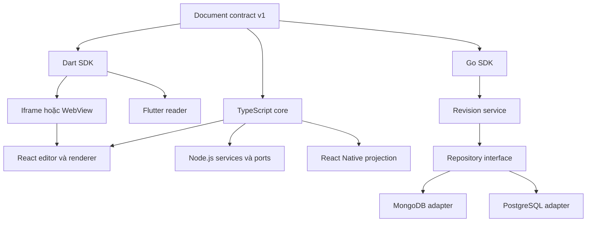

# Kiến trúc DisNote Document Library

Bộ tài liệu này mô tả mã nguồn được kiểm tra ngày 20/11/2026. Các phiên bản trong manifest là phiên bản của checkout, không phải xác nhận đã phát hành lên registry.

## 1. Đọc tài liệu nào?

| Tài liệu | Nội dung |
|---|---|
| [Kiến trúc](ARCHITECTURE.md) | Mô hình dữ liệu, module, luồng xử lý, bảo mật và mở rộng |
| [TypeScript](TYPESCRIPT.md) | React, React Native, backend Node.js/NestJS, spreadsheet và phát hành npm |
| [Backend Go](GO_BACKEND.md) | SDK Go, Gin, Uber Fx, revision, database và hợp đồng HTTP |
| [Frontend Flutter](FLUTTER.md) | Dart model, reader, iframe/WebView editor, NestJS client và pub.dev |

Đây là bốn tài liệu chính trong `docs/`. README, changelog và giấy phép nằm ở từng package phục vụ việc đóng gói/phát hành.

## 2. Mục tiêu và ranh giới

DisNote sở hữu định dạng tài liệu bền vững, validation, migration và các hợp đồng tích hợp. BlockNote là adapter chỉnh sửa web; dữ liệu nội bộ của editor không phải định dạng lưu trữ công khai.

| Thành phần | Vai trò | Không tự đảm nhận |
|---|---|---|
| `@disnote/core` | Document model, registry, builders, validation và các subpath chuyên biệt | Đăng nhập, vận hành API và database của sản phẩm |
| `@disnote/react` | Editor/view facade cho React, runtime dependencies và CSS | Tự lưu dữ liệu hoặc quyết định quyền truy cập |
| `@disnote/sheets` | Engine workbook độc lập, công thức, chuyển đổi và persistence ports | Giao diện bảng tính hoàn chỉnh |
| `sdks/flutter` | Dart model, renderer, editor bridge, Nest client và session | Editor Dart thuần tương đương BlockNote |
| `../DisNote-Go-SDK` | Model, validation, canonical checksum, revision, Gin/Fx và storage | Toàn bộ tính năng của nền tảng TypeScript |

Ứng dụng Flutter có thể tiếp tục dùng NestJS. Việc có Go SDK không bắt buộc thay backend.

## 3. Sơ đồ phụ thuộc



Core model không import React hay BlockNote. Adapter UI, database và transport nằm ngoài core. Composition root của ứng dụng cung cấp dependency theo interface.

## 4. Cấu trúc nguồn

| Đường dẫn | Nội dung |
|---|---|
| `packages/disnote/src/core` | Model, registry, validation, security, migration, serialization và transforms |
| `packages/disnote/src/presets` | Preset article, legal, workspace |
| `packages/disnote/src/editor` | Canonical/editor adapter và React facade |
| `packages/disnote/src/react` | `DocumentEditor`, `DocumentView`, `DocumentPage` |
| `packages/disnote/src/renderer-*` | React, HTML và native renderer |
| `packages/disnote/src/storage`, `persistence` | Revision contracts, repositories, browser/Mongo/PostgreSQL adapters |
| `packages/disnote/src/database`, `workspace` | Record database, cây trang và các control React |
| `packages/disnote/src/comments`, `assets`, `search-ai` | Ports và nghiệp vụ theo capability |
| `packages/disnote/src/collaboration`, `offline`, `mobile` | Đồng bộ, hàng đợi offline và bridge |
| `packages/disnote/src/import-export` | Markdown, HTML, bundle, Notion và DOCX |
| `packages/react` | Package tích hợp React tiện dụng |
| `packages/sheets` | Spreadsheet engine độc lập |
| `contracts/go/v1` | Fixture hợp đồng dùng chung giữa các runtime |
| `scripts/export-runtime-contracts.mjs` | Xuất fixture sang Flutter và Go |
| `sdks/flutter/lib` | API Dart công khai và implementation Flutter |
| `examples` | Ví dụ React, Next.js, Nest legal service, collaboration server |
| `../DisNote-Go-SDK` | Repository Go riêng, không phải npm workspace |

Danh sách import hợp lệ phải đối chiếu với `exports` của từng `package.json`. Tên thư mục implementation không luôn trùng với import công khai: ví dụ `renderer-native` được import bằng `@disnote/core/renderer/native`.

## 5. Document contract

```json
{
  "format": "disnote-document",
  "schemaVersion": 1,
  "id": "doc_example",
  "metadata": {
    "title": "Ví dụ",
    "locale": "vi",
    "createdAt": "2026-11-20T00:00:00.000Z",
    "updatedAt": "2026-11-20T00:00:00.000Z"
  },
  "blocks": [{
    "id": "block_example",
    "type": "paragraph",
    "version": 1,
    "props": {},
    "content": [{ "type": "text", "text": "Nội dung" }]
  }]
}
```

Mỗi block có ID, type, version, JSON props, inline content tùy chọn và children tùy chọn. Inline gồm text, link, mention và reference. Text marks gồm bold, italic, underline, strike, code, textColor và backgroundColor. Superscript/subscript và các cấu trúc nâng cao phải đi qua hợp đồng thực tế của block/editor; không tự thêm mark chưa được validator hỗ trợ.

Ba phiên bản độc lập: phiên bản package, `schemaVersion` của document và `version` của block. Nâng npm package không đồng nghĩa tự đổi schema. Canonical JSON/checksum dùng để so sánh nội dung; checksum không thay thế chữ ký hoặc phân quyền.

Unknown block có thể được bảo toàn ở chế độ permissive. Khi ghi dữ liệu nghiệp vụ, host cần registry đầy đủ và policy cho unknown block; TypeScript revision repository dùng strict validation. Unknown block được giữ không có nghĩa mọi renderer đều hiển thị được.

## 6. Luồng đọc, sửa và lưu

1. Backend xác thực người dùng và kiểm tra quyền đối với document/workspace/channel.
2. Repository trả canonical document cùng revision hiện tại.
3. UI render document hoặc chuyển qua editor adapter.
4. Editor trả canonical document; hook/controller phía client quản lý draft và trạng thái lưu.
5. Request lưu gửi document, revision mong đợi và idempotency key.
6. Backend kiểm tra lại quyền, ID, schema, block props và hạn mức đầu vào.
7. Repository ghi nguyên tử bằng CAS; thành công tạo revision mới, xung đột giữ nguyên draft phía client.
8. Host phát sự kiện sau khi persistence thành công; thông báo realtime không thay thế receipt lưu.

`currentRevision` là revision nội dung. Store CAS version có thể đổi khi publish/archive mà không tạo nội dung mới. Không hoán đổi hai giá trị này.

TypeScript repository có draft/publish/unpublish/archive và truy vấn published revision. Go service hiện có create/read/save draft; trường status trong model không chứng minh đã có API publish.

## 7. Editor theo nền tảng

| Nền tảng | Đọc | Chỉnh sửa |
|---|---|---|
| React Web | `DocumentView`/`DocumentRenderer` | `DocumentEditor` hoặc `DisNoteEditor` |
| Node.js | HTML/SSR, plain text và dữ liệu canonical | Thay đổi bằng builders/transforms/service |
| React Native | `DocumentNativeRenderer`, inject native primitives | `NativeDocumentEditor`, inject WebView tới trang React |
| Flutter Web | `DisNoteDocumentView` | Iframe sandbox qua `DisNoteDocumentEditor` |
| Flutter Android/iOS | `DisNoteDocumentView` | WebView qua cùng widget editor |
| Go | Model, validation, checksum và revision service | API backend; không có UI renderer/editor |

Bridge là giao thức message có version, kiểm tra document ID, loại message và kích thước. Trang editor phải được triển khai riêng trên origin tin cậy. Callback thay đổi chỉ là draft mới; chưa phải bằng chứng đã lưu backend.

## 8. Module nghiệp vụ mở rộng

| Module | Tích hợp tại host |
|---|---|
| Database/workbench | Provider có quyền hiện tại, record CRUD/query/view, record-document access |
| Workspace | Repository cây trang, move/trash/restore/backlink/shared-source |
| Comments/mentions | Provider đọc/ghi thread, tìm mention có phân quyền |
| Assets | Upload/presign, quota, MIME/size, scan và signed URL do backend sở hữu |
| Collaboration | Yjs provider, identity, token, persistence update và generation fence |
| Offline | Queue/cache cục bộ và giải quyết xung đột khi kết nối lại |
| Search/AI | Projection và provider được inject; quyền đọc và credentials ở server |
| Automation | Scheduler/webhook executor và policy server-side; UI không tự thực thi quyền |
| Sheets | Workbook riêng; liên kết với document bằng ID nếu sản phẩm cần |

Các provider tham chiếu/demo không đại diện cho một deployment production. Với realtime, host phải xử lý thu hồi quyền, reconnect, seed duy nhất và replay; không seed độc lập cùng nội dung vào mỗi Y.Doc.

## 9. Chuyển đổi và mức bảo toàn

Canonical JSON là nguồn lưu trữ. Markdown và HTML là định dạng trao đổi có thể mất metadata, ID hoặc custom block; đọc warnings khi chuyển đổi.

DOCX do DisNote tạo chứa nội dung Word và snapshot canonical kèm checksum. Import khôi phục snapshot chỉ khi kiểm tra hợp lệ. Nếu Word content bị sửa hoặc file đến từ bên ngoài, importer chuyển sang semantic parsing và phát diagnostics; không có cam kết giữ nguyên mọi bố cục Word.

XLSX trong sheets có cơ chế snapshot/semantic fallback riêng. Spreadsheet và document không dùng chung model. PDF/Excel/Word fidelity cần kiểm chứng theo file thật; không suy ra từ việc export tạo được byte array.

## 10. SOLID, mở rộng và migration

- Controller xử lý transport; service xử lý nghiệp vụ; repository xử lý database.
- UI component hiển thị; hook/session quản lý draft và side effects; serializer/validator tách riêng.
- Custom block cần schema, props validator, plain-text projection, migration và renderer tương ứng từng nền tảng.
- Mở rộng qua registry/preset, provider hoặc strategy; không patch vendor editor để thay định dạng canonical.
- Migration có tính quyết định, không gọi network, không phụ thuộc user hiện tại và không sửa dữ liệu gốc khi lỗi.
- UI host dùng từ điển vi/en; event names, storage keys, routes và error identifiers đặt trong constants.

## 11. Bảo mật và vận hành

Client-side `editable`, `canManage` hoặc `canEdit` chỉ điều khiển UI. Node host phải bọc repository bằng authorization service; Go service yêu cầu `revision.Policy` và mặc định từ chối khi thiếu policy.

Không lấy actor từ body/header tự khai báo rồi tin cậy. Không đưa access/refresh token vào editor URL. Giới hạn request body, nesting depth, ZIP/XML expansion, asset origins và thời gian xử lý import. Custom HTML renderer phải escape dữ liệu và kiểm tra URL.

Repository aggregate chứa cả lịch sử có thể tăng kích thước theo thời gian. Cần thiết kế retention/compaction và đo tải trước khi dùng cho lịch sử lớn. Live database, thiết bị thật, IME, bàn phím, offline, thu hồi quyền và deployment cần các gate riêng.

## 12. Bản đồ kiểm chứng tài liệu

| ID | Yêu cầu | Nguồn đối chiếu |
|---|---|---|
| DOC-01 | Đúng bốn tài liệu chính | Bốn file Markdown trong `docs/` |
| DOC-02 | Kiến trúc và contract đúng nguồn | `core/model`, registry, storage, `package.json` exports |
| DOC-03 | React/React Native/Node.js | `react/index.tsx`, `renderer-native`, `mobile`, `persistence` |
| DOC-04 | Go/Gin/Fx | `../DisNote-Go-SDK/{revision,transport/gin,fxmodule,storage}` |
| DOC-05 | Flutter Web/mobile và Nest client | `sdks/flutter/lib`, pubspec và publish workflow |
| DOC-06 | Liên kết và ví dụ hợp lệ | Kiểm tra file đích và đối chiếu chữ ký API; build/test được báo riêng theo lần chạy |

Đây là bản đồ nguồn cho tài liệu, không phải nghiệm thu UI/API/database/realtime của sản phẩm. Việc sửa tài liệu không bổ sung endpoint, policy hoặc khả năng runtime mới.
