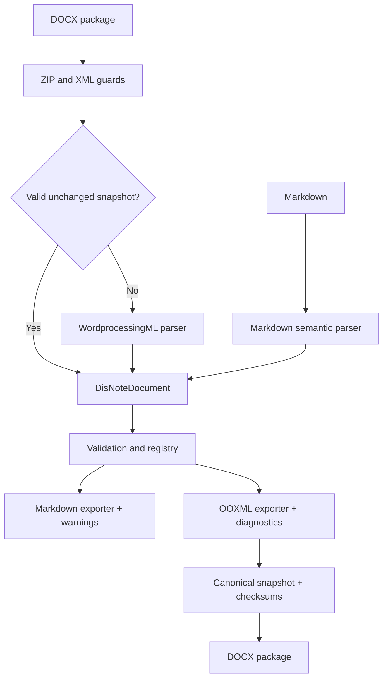

# DOCX ↔ Markdown conversion architecture

Status: implemented library boundary, 2026-11-15.

## 1. Goals

The conversion subsystem must:

1. keep `DisNoteDocument` as the only canonical document model;
2. round-trip a DisNote-generated DOCX without losing custom blocks or metadata;
3. semantically import external Word files when no trusted DisNote snapshot exists;
4. detect edits, corruption and unsupported content instead of silently using stale data;
5. remain independent from Microsoft Word, Pandoc and editor vendors;
6. allow future domain blocks to extend conversion without raw-OOXML access;
7. bound archive expansion, XML size, entry count and document block count.

## 2. Boundary map



DOCX and Markdown are interchange formats. Neither may become the persisted
source of truth.

## 3. Exact and semantic modes

### Exact DisNote round-trip

`exportDocx` writes:

- semantic `word/document.xml` for Word interoperability;
- styles and numbering parts;
- a canonical DisNote snapshot in `customXml/disnote-document.xml`;
- a canonical document checksum;
- a checksum of `word/document.xml`.

`importDocx` restores the embedded document only when both checksums and document
validation pass. This retains unknown/custom blocks, stable IDs, versions,
properties and metadata exactly.

### Edited or external Word file

If `word/document.xml` changed, the snapshot is stale. The importer then parses
WordprocessingML and emits `embedded-snapshot-stale`. It currently maps:

| Word semantic | DisNote block/inline |
|---|---|
| Heading 1–3 | `heading` |
| Normal paragraph | `paragraph` |
| Bullet/decimal numbering | list items |
| Checkbox glyph | `checklistItem` |
| Quote style | `quote` |
| DisNote code style | `codeBlock` |
| DisNote callout style | `callout` |
| Table rows/cells | `table` |
| Bold/italic/underline/strike/code | text marks |
| External safe hyperlink relationship | `link` |
| Horizontal paragraph border | `divider` |

Unrecognized extension content becomes an explicit placeholder or is delegated
to a registered `DocxBlockCodec`. It is never interpreted as raw executable XML.

## 4. Extension contract

```ts
interface DocxBlockCodec {
  blockType: string;
  toWordText(block: DisNoteBlock): string;
  fromWordText(text: string): DisNoteBlock | null;
}
```

The codec boundary is intentionally text-based. Extensions cannot inject raw
OOXML, relationships or package paths. This protects package validity and keeps
security review centralized.

## 5. Public API

```ts
import {
  convertDocxToMarkdown,
  convertMarkdownToDocx,
  exportDocx,
  importDocx,
} from "@disnote/core/import-export/docx";

const word = convertMarkdownToDocx(markdown, { now: new Date().toISOString() });
const markdownResult = convertDocxToMarkdown(word.bytes);

// Always inspect both collections.
console.log(word.warnings, word.diagnostics);
console.log(markdownResult.warnings, markdownResult.diagnostics);
```

Applications must not ignore warnings when performing migrations or bulk
conversion.

## 6. Security invariants

- Maximum input archive: 64 MiB.
- Maximum expanded entry: 32 MiB.
- Maximum entry count: 2,000.
- Maximum XML part: 16 MiB.
- Maximum imported blocks: 50,000.
- Absolute and parent-traversal package paths are rejected.
- Embedded JSON must pass checksum and document validation.
- Hyperlinks accept only the shared safe URL policy.
- Extension codecs receive text, not OOXML.
- Macros, external templates, remote images and executable relationships are not
  executed or fetched.

## 7. Fidelity policy

| Content | Policy |
|---|---|
| Core text/list/table structures | Semantic DOCX and Markdown mapping |
| DisNote extension block | Exact snapshot; codec projection after Word edit |
| Mention/reference | Human-readable Word text; exact snapshot retains identity |
| Asset without supplied bytes | Placeholder/diagnostic; never fabricate content |
| Word drawing, SmartArt or tracked change not mapped | Diagnostic/fallback; no silent success |
| Unedited DisNote DOCX | Canonical exact restoration |
| Edited DOCX | Semantic reconstruction; stale snapshot rejected |

Perfect visual equivalence with every Word producer is not claimed. Word layout
uses a pagination/rendering engine unavailable to a pure document-model library.
The contract guarantees deterministic data behavior and honest diagnostics.

## 8. Testing strategy

Required test classes:

- exact canonical round-trip including Unicode and custom blocks;
- edited-document stale-checksum fallback;
- external WordprocessingML semantic mapping;
- Markdown ↔ DOCX convenience pipeline;
- custom codec recovery after editing;
- malformed archive, path traversal and expansion bounds;
- unsafe relationships and corrupted snapshot fallback;
- package dry-run containing JS and declaration exports.

Live Microsoft Word/LibreOffice fixtures and a broader public DOCX corpus remain
separate compatibility gates because they require those runtimes and licensed or
redistributable documents.

## 9. Maintenance rules

1. New core blocks must declare DOCX and Markdown behavior in the block delivery
   checklist.
2. Never add a switch-only domain block; prefer a `DocxBlockCodec`.
3. Schema changes require migrations before converter changes.
4. Every new OOXML relationship type requires an explicit allow/deny decision.
5. Diagnostics are public API: add rather than silently change their meaning.
6. Update this document, the acceptance ledger and Graphify after structural
   changes.
