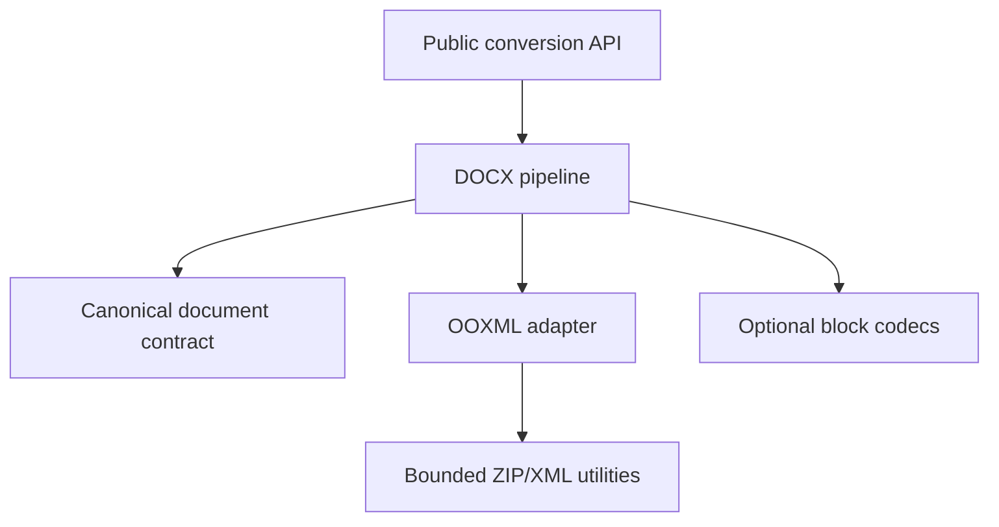

# Graphify architecture receipt - 2026-11-15

This receipt describes the generated dependency graph for the current DisNote
Document Library checkout. The graph is an inspection aid; source code, tests,
ADRs and public contracts remain authoritative.

## Snapshot

| Metric | Value |
|---|---:|
| Code files extracted | 335 |
| Nodes | 2,719 |
| Raw edges | 7,300 |
| Dangling edges | 0 |
| Missing endpoints | 0 |
| External endpoints | 0 |
| Exact duplicate edges | 0 |

The graph was generated with code-only extraction and without clustering so
module boundaries remain traceable to repository paths.

## Generated artifacts

| Artifact | Purpose |
|---|---|
| `graphify-out/graph.json` | Canonical machine-readable graph |
| `graphify-out/graph.graphml` | Import into GraphML-compatible analysis tools |
| `graphify-out/graph.html` | Interactive graph explorer |
| `graphify-out/GRAPH_TREE.html` | Repository/module tree explorer |
| `graphify-out/CALLFLOW.html` | Top call-flow report |
| `graphify-out/manifest.json` | Incremental extraction manifest |

## Architectural interpretation

High-degree symbols such as `DisNoteDocument`, `DisNoteBlock` and
`createDocument` are expected contract hubs. New feature implementations should
depend on these stable contracts, not make the contracts depend on database,
editor, UI or OOXML implementations.

The DOCX path follows this direction:



MongoDB and PostgreSQL adapters remain leaf implementations behind the shared
document repository contract. UI packages remain consumers of the core model.

`@disnote/sheets` forms a second dependency root for workbook behavior. It has
no edge to the document model, React, BlockNote or concrete database drivers;
CSV/XLSX, formulas and persistence implementations point toward its workbook
contract.

## Regeneration workflow

Run from the repository root after a material architectural change:

```powershell
graphify extract . --code-only --no-cluster
graphify tree --graph graphify-out/graph.json --output graphify-out/GRAPH_TREE.html --root . --label "DisNote Document Library"
graphify export graphml --graph graphify-out/graph.json
graphify export html --graph graphify-out/graph.json
graphify export callflow-html graphify-out --graph graphify-out/graph.json --output graphify-out/CALLFLOW.html --lang en --max-sections 20
graphify diagnose multigraph --graph graphify-out/graph.json --json
```

Review graph changes together with public API changes, tests and an ADR when a
dependency direction or ownership boundary changes. A generated graph alone is
not acceptance evidence for behavior.
