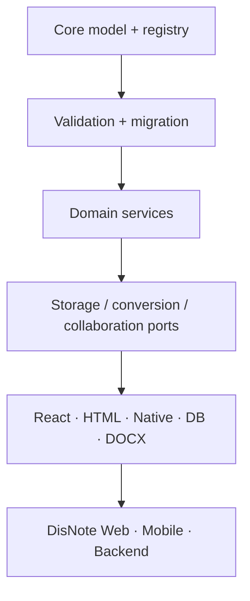

# Long-term maintenance architecture

## Architectural north star

DisNote Document Library is a vendor-neutral document platform. The stable
center is the validated, versioned `DisNoteDocument`; React, BlockNote, Yjs,
MongoDB, PostgreSQL, Word and Markdown are replaceable adapters.

Spreadsheet is a sibling platform, not a document block. Its stable center is
the validated `SpreadsheetWorkbook` in `@disnote/sheets`. Document and Sheet may
be composed by a host application through IDs/permissions, but neither core
package imports the other.

Dependencies flow downward toward the model. Core must never import React,
BlockNote, NestJS or database drivers.

## Module ownership

| Module | Owns | Must not own |
|---|---|---|
| `core` | schema, registry, migration, validation, canonical serialization | UI, HTTP, database |
| `editor` | vendor state conversion and editor commands | persisted vendor JSON |
| `renderer-*` | safe presentation | business authorization |
| `import-export` | bounded format adapters and diagnostics | canonical persistence |
| `storage` | repository contracts and revision semantics | concrete UI |
| `persistence/*` | replaceable DB adapters | business policy |
| `collaboration` | update/snapshot protocols | trusted identity issuance |
| `database` | typed record/query/automation domain | host access bypass |
| `react` | composition and interaction surfaces | direct database/API calls |
| `@disnote/sheets` | workbook schema, formulas, CSV/XLSX and workbook persistence ports | document blocks, React, vendor grids, database drivers |

## Evolution rules

- Public API changes require a Changeset and package dry-run.
- Schema changes require a deterministic migration and old fixture.
- Block additions require validation, renderer, editor, plaintext, conversion,
  security and round-trip coverage.
- Storage implementations must pass the same contract suite.
- Feature evidence is tracked by acceptance ID, never inferred from filenames.
- External providers are injected ports, never imported into core.

## Reliability model

1. Validate at every untrusted boundary.
2. Use optimistic revision checks and actor-scoped idempotency for mutations.
3. Preserve unknown blocks and produce diagnostics for lossy formats.
4. Bound recursion, archive expansion, query pages and payload size.
5. Keep published revisions immutable.
6. Make cancellation/close idempotent for realtime and async resources.
7. Run build, lint, unit, examples, Storybook, browser and configured live-service
   gates before release.

## Repository reading order

1. `README.md`
2. `GUIDELINE.md`
3. `docs/ARCHITECTURE.md`
4. `docs/DOCUMENT_FORMAT_V1.md`
5. `docs/LONG_TERM_MAINTENANCE_ARCHITECTURE.md`
6. domain-specific contract document
7. Graphify `graphify-out/REPORT.md` and interactive graph

## Decision records

Important irreversible choices belong in `docs/adr`. An ADR must state context,
decision, alternatives, consequences and migration impact. Code comments explain
local intent; ADRs explain project direction.

## Definition of done

A capability is complete only when applicable model, API, policy, persistence,
event/realtime, UI and tests have current evidence. Compile success alone proves
only type compatibility. Runtime-specific claims require that runtime.
