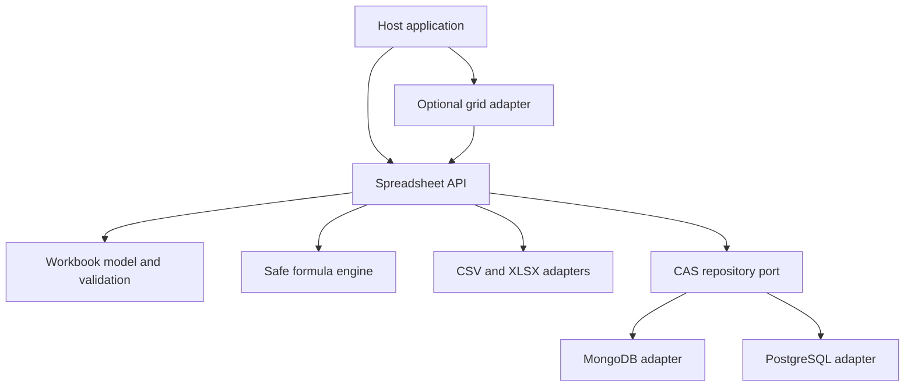

# Standalone Spreadsheet architecture

## Decision

Spreadsheet is a first-class sibling of Document, not a table block inside a
document. Consumers install `@disnote/sheets` independently and may attach any
grid UI, API, authorization model or database driver through adapters.

`@disnote/sheets` does not import `@disnote/core`, React, BlockNote, MongoDB or
`pg`. Structural database ports let the host supply its installed driver.

## Stable model

`SpreadsheetWorkbook` is a versioned envelope containing sparse worksheets.
Cells are keyed by normalized A1 addresses and may contain a scalar value, an
Excel-style formula, presentation metadata and a note. Worksheet metadata owns
dimensions, merged ranges, frozen panes and visibility.

The current hard bounds match the XLSX grid limit: 1,048,576 rows and 16,384
columns. Validation also bounds sheets, populated cells, formulas, ranges,
archive entries and expanded archive bytes.

## Formula engine

The parser is deterministic and never calls `eval` or `Function`. It supports:

- A1, absolute A1 and quoted/unquoted cross-sheet references;
- ranges, arithmetic, exponentiation, percentages, concatenation and comparisons;
- `SUM`, `AVERAGE`, `MIN`, `MAX`, `COUNT`, `COUNTA`, `IF`, `AND`, `OR`, `NOT`,
  `CONCAT` and `ROUND`;
- lazy conditional/boolean evaluation, dependency memoization and cycle errors;
- bounded depth/range size and host-defined functions through plugins.

This is an explicit supported subset, not a claim of complete Microsoft Excel
formula compatibility. Volatile, external-workbook, array/spill, financial,
lookup and locale-specific formula families remain extension work.

## CSV and XLSX fidelity

CSV parsing follows quoted-field, escaped-quote, CRLF and multiline-field rules.
Import may infer finite numbers and booleans or retain all values as strings.

XLSX export uses standard OOXML workbook/worksheet relationships, inline strings,
formula cells, booleans, numbers, dimensions, merged ranges, hidden sheets,
column widths and frozen panes. DisNote-generated workbooks include a checksummed
canonical snapshot. If worksheet XML changes, import rejects that snapshot and
uses semantic XLSX parsing.

External XLSX import currently maps sheets, sparse cells, shared/inline strings,
cached values, formulas, merges, frozen panes and visibility. Complex styles,
conditional formatting, charts, images, comments, macros, pivot tables, data
validation, external links and protected/encrypted files are not yet semantically
mapped. Diagnostics expose unsupported style boundaries.

## Persistence and integration

`RevisionWorkbookRepository` owns optimistic revision checks and idempotent save
retries. `WorkbookStateRepository` is the narrow storage port. Implementations
exist for memory and structural MongoDB/PostgreSQL clients.

Host applications remain responsible for authentication, authorization, tenant
isolation, quotas, audit logs, realtime events, encryption and object storage.
Those policies must be enforced before calling the repository.

## Extension rules

- Add formula functions through `SpreadsheetPlugin`, never by editing parser
  dispatch in a host product.
- Put vendor-grid mapping in a separate adapter package.
- A schema change requires migration fixtures and round-trip tests.
- Every XLSX feature must state whether it is exact, semantically mapped, lossy
  with diagnostics or unsupported.
- Database implementations must pass the same CAS/idempotency contract.
